# SCGSS Database Guide

SCGSS keeps its records in one PostgreSQL 16 database, `app_scgss`, with its own login `app_scgss`, on the apps VM (`127.0.0.1:5432`). Uploaded files are **not** in the database: they sit on disk in `/srv/apps/scgss/data/files`, named by file id, and the database holds only their details. The tables are created by the app when it starts, so there is no separate install script. `server/db.js` is the source of truth.

## Tables



The diagram shows the eight main tables. `kv` (counters) and `dedupe` (duplicate-send keys) are housekeeping and are not drawn. Editable source: `diagrams/database.html`.

| Table | Holds | Key | Link to other tables (kept by the app, not by database constraints) |
|---|---|---|---|
| `scgss_users` | Who may sign in, and in which role: `email`, `role` (student, adviser, chair, assoc, dean, admin, sysadmin), `name`, `program` (the department for a Chair), `active`, `updated_at` | `email` | `apps.student_email`, `drafts.email`, `sigs.email` |
| `apps` | One row per application. `ref` (such as `2627-Term1-001`, unique), `student_email`, `status`, and `data` (JSON, see below) | `id` (like `a12`) | `files.app_id` |
| `files` | Details of each uploaded file in `data` (JSON): original name, stored name, size, type, who uploaded, which application, Drive folder, whether it was sent to Drive | `id` (like `f7`) | `apps.id` through `app_id` |
| `notifs` | In-app notices: `to_email`, and `data` (title, body, time, read) | `id` | `apps` through `data.appId` |
| `outbox` | A log of the notification emails sent (recipient, subject, body). The latest 500 are kept. It is a record, not a queue | `id` | none |
| `drafts` | A student's unsent form, one per person | `email` | `scgss_users` |
| `sigs` | A saved signature image (PNG as text), one per person | `email` | `scgss_users` |
| `audit` | Access log: `ts`, `email`, `event`, `detail`, `ip`. Events include `student_auto`, `no_access`, `user_set`, `user_bulk`, `import`, `action_refused`, `file_view`, `file_download`, `data_export`. Deleted after `AUDIT_KEEP_DAYS` (365) | `id` | none |
| `kv` | Two settings the app needs: `seq` (next id number) and `counters` (the last reference number for each year and term) | `k` | none |
| `dedupe` | Keys that stop the same notice or reminder from being sent twice | `k` | none |

`apps.status` is one of `pending`, `returned`, `rejected`, `approved`, `verified`, `completed`. The same values are shown in the app (see `docs/WORKFLOW.md`).

## What is inside `apps.data`

The whole application is one JSON document, so a change of rules rarely needs a table change.

| Part | Contents |
|---|---|
| Identity | `id`, `ref`, `key` (year-term), `ay`, `term`, `created`, `updated` |
| Applicant | `studentEmail`, `studentName`, `sid` (student ID), `program`, `year` |
| `conf` | Conference `title`, `start`, `end`, `venue`, `org`, `etype`, `scope` (event location, which sets the grant limit) |
| `paper` | Paper class, type, index, title, co-author details |
| `expenses` | List of `type`, `amount`, `remarks`, and later `approved` and `fund` |
| `route` | Emails of the `adviser`, `chair`, `assoc` and `dean` for this application |
| `stage`, `cycle` | Position in the approval chain (0 adviser, 1 chair, 2 associate dean, 3 dean); round number after returns |
| `decisions` | One entry per step: `endorsed`, `returned`, `skipped`, `approved`, with who and when |
| `grant` | The Dean's single `total`, `fund` (funding source), who, when, and the signature image |
| `post` | Post-activity report: `status` (none, submitted, returned), `cycle`, items, `verify` result and approved total |
| `report` | The reimbursement report: `no` (`RR-<ref>`), who, when, `rfp` |
| `privacy` | When the student accepted the notice and the notice version (`at`, `v`) |
| `comments`, `history` | Messages and the approval history, in order |
| `attach`, `viewed` | The requirements PDF and who has opened which document |

## Looking at the data

Open it as the Postgres superuser, and use `SELECT` only:

```bash
sudo -u postgres psql app_scgss
```

```sql
\dt
SELECT status, count(*) FROM apps GROUP BY status;
SELECT ref, student_email, status, data->>'stage' AS stage FROM apps ORDER BY seq DESC LIMIT 20;
SELECT email, role, program, active FROM scgss_users ORDER BY role, email;
SELECT ts, email, event, detail FROM audit ORDER BY id DESC LIMIT 20;
SELECT id, app_id, data->>'name' AS stored_name, data->>'pushed' AS sent_to_drive FROM files ORDER BY id DESC LIMIT 20;
```

Do not `UPDATE`, `DELETE` or `DROP` by hand. The app keeps copies in memory and checks the data on every action, so a manual change can be overwritten or can break a record. Use the Roles tab or `server/users.js` for people, and ask for a fix in the code for anything else. `node users.js export <email>` produces everything held on one person.

## Backup and restore

- **Nightly:** `deploy/apps-backup.sh` writes a `pg_dump` and a tar of the files folder, encrypts both with `age`, and copies them to the shared Drive. It needs `AGE_PUBLIC_KEY` set, plus `age` and `rclone`. Keep the private key off the server.
- **Quick copy before an update** (no encryption tools needed): `sudo bash -c 'umask 077; sudo -u postgres pg_dump -Fc app_scgss > /var/backups/app_scgss-before-update.dump'`, then delete it after the update is confirmed. It contains personal data, so do not email it or leave it in a shared folder.
- **Restore test** (do one before go-live): create an empty database, run `pg_restore -d <empty database> <dump file>`, and compare `SELECT count(*) FROM apps;` with the live database.
- Restore the files folder from the same night's tar, or the application records will point to files that are missing.

## Privacy and retention

The database holds personal data, so the rules in `docs/DATA-PRIVACY.md` apply: only the System Administrator opens it, access logs are deleted after the set period, and a period for `apps`, `files`, `sigs` and the Drive copies still has to be set by the Records Officer and Finance. Nothing deletes those rows automatically yet.
