# SCGSS Workflow

This is the written version of the **Workflow** tab in the app. The rules are enforced on the server in `server/engine.js` (and `shared/rules.js`), not only by the buttons.

## Status at a glance

Editable source: `diagrams/workflow.html`.

## Phase 1: application and approval

1. **Submit.** The student picks the academic year, term, degree program and Thesis Adviser, fills in the conference, paper and expense details, attaches **one PDF**, confirms it, and accepts the data privacy notice. The system gives a reference such as `2627-Term1-001`, names the file after it, and notifies the adviser. The grant limit depends on the event location: NCR ₱6,000; Luzon ₱8,000; Ilocos, Cagayan or Bicol ₱10,000; Visayas or Mindanao ₱12,000; international ₱15,000.
2. **Route.** The application goes in order to the **Thesis Adviser, Department Chair** (of the student's degree program), **Associate Dean**, then **Dean**. Each of the first three can **Endorse**, **Return with remarks**, or **Reject** (a reason is required). Only the person whose turn it is can act, and a student can never act on their own application.
3. **Return.** The status becomes `returned`. The student replies, uploads documents or edits the form, and resubmits. The same approver continues and earlier decisions are kept.
4. **Approve.** The **Dean** enters **one grant amount and one funding source** and confirms. No signature at this step (since 1.0.0-rc.6). The amount cannot be above the limit for the event location or above what the student projected. The status becomes `approved`, and the student and the Administrative Assistant are notified. The Administrative Assistant breaks the amount down later, per receipt.
5. **Reject.** The application closes. The reason and all earlier decisions stay on record.

**When one person holds two roles:**
- A person who already endorsed does not endorse again; their later endorsement step is skipped and logged.
- The **Dean is the adviser:** the Associate Dean does not endorse; the Associate Dean approves the grant in the Dean's place.
- The **Chair is the adviser:** the Chair step is skipped, and the Associate Dean is next.
- The **Associate Dean is the adviser:** that step is skipped, and the Dean is next.

An application cannot be submitted until the Dean, Associate Dean and the Chair of that department exist in the Roles tab.

## Phase 2: post-activity report and reimbursement

1. **Report.** After the event, within **15 days** of its end date, the student lists each expense (OR or invoice number, merchant, amount; no Per diem) and makes three uploads: (a) one consolidated PDF with, in order, proof of acceptance or invitation, official receipts or invoices, billing statements, itinerary receipts, peso conversion rate and Student ID (a missing document is allowed with the student's explanation); (b) the Post-Conference Report (PDF); (c) an article write-up of 300 to 500 words (conference title, date, location from the application, summary of the work and key learnings) with a high-resolution poster or social media graphic. The article may be used for CCS News and Events.
2. **Reminders.** The system emails and notifies the student 15, 7, 3 and 1 days before the due date, on the due date, and every 3 days when overdue. Each reminder is sent once (a key in `dedupe` prevents repeats).
3. **Verify.** The Administrative Assistant ticks each of the six documents in the PDF, the Post-Conference Report and the article with its graphic, checks the receipts, sets the **approved amount and funding source per item**, and either sends the validated **Summary of Expenses to the Dean** (`post.status` `dean`) or **returns** the report to the student with remarks. A returned report is resubmitted as a new version and the original is kept.
4. **Dean approves the summary.** The Dean (or the approver in the Dean's place) reviews the Summary of Expenses, adds a **digital signature** and approves it (status `verified`). The Dean can instead **return** it to the Administrative Assistant with remarks; it goes back to the Verification screen. Before or during this, the Administrative Assistant can ask the Dean about a funding source or an amount as a message.
5. **File.** Only after the Dean's approval can the **Student Conference Grant Summary of Expenses** (`SOE-<ref>`, the College's form, with the Dean's signature) be downloaded or printed. The Administrative Assistant submits it to the FAO and enters the **RFP number**. The status becomes `completed` and the student is emailed: the request was submitted to the FAO with the RFP number; check the status at Window A or B, Finance Office, St. La Salle Hall, in about 5 to 10 business days; bring the original receipts or invoices.

## Who can do what

| Action | Student | Adviser | Chair | Assoc. Dean | Dean | Admin. Asst. | Sys. Admin |
|---|---|---|---|---|---|---|---|
| Submit, reply, resubmit, submit the report | Own only | | | | | | |
| Endorse, return or reject | Never own | Step 1 | Step 2 | Step 3 | | | |
| Approve the grant | | | | | Step 4 (or the Associate Dean when the Dean is the adviser) | | |
| Verify documents, return requirements, file at FAO | | | | | | Yes | |
| Send reminders | | | | | | Yes | Yes |
| See applications | Own | Assigned | Assigned | Assigned | Assigned | All | All |
| Manage roles | | | | | | | Yes |

## What is recorded and where it goes

- Every action is written to the application's **approval history**, and refused attempts are written too.
- After each change the application row is written to the **Google Sheet**, and each uploaded file is copied to **Google Drive** under `Applications/<year-term>`.
- Each change sends an **email** and an **in-app notice** to the person who must act next, and to the student. Emails show the applicant, reference, event, dates and status, never amounts.
- Sign-in problems, role changes, file views and downloads go to the **access log** (see `docs/DATABASE.md`).

## Known gaps

- A Google sync that fails is logged once and not retried.
- There is no automatic deletion of finished applications (see `docs/DATA-PRIVACY.md`, section 6).
