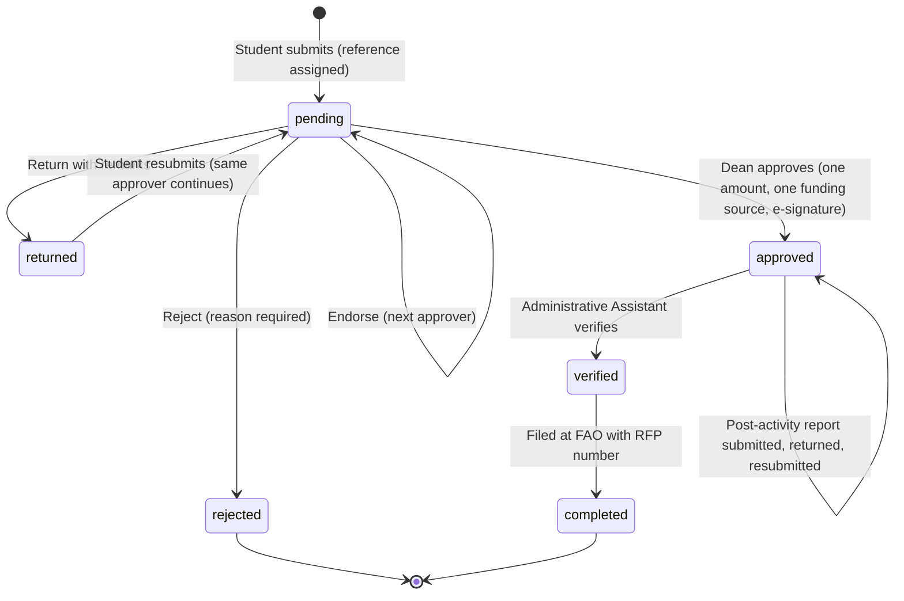

# SCGSS Workflow

This is the written version of the **Workflow** tab in the app. The rules are enforced on the server in `server/engine.js` (and `shared/rules.js`), not only by the buttons.

## Status at a glance

## Phase 1: application and approval

1. **Submit.** The student picks the academic year, term, degree program and Thesis Adviser, fills in the conference, paper and expense details, attaches **one PDF**, confirms it, and accepts the data privacy notice. The system gives a reference such as `2627-Term1-001`, names the file after it, and notifies the adviser. The grant limit depends on the event location: NCR ₱6,000; Luzon ₱8,000; Ilocos, Cagayan or Bicol ₱10,000; Visayas or Mindanao ₱12,000; international ₱15,000.
2. **Route.** The application goes in order to the **Thesis Adviser, Department Chair** (of the student's degree program), **Associate Dean**, then **Dean**. Each of the first three can **Endorse**, **Return with remarks**, or **Reject** (a reason is required). Only the person whose turn it is can act, and a student can never act on their own application.
3. **Return.** The status becomes `returned`. The student replies, uploads documents or edits the form, and resubmits. The same approver continues and earlier decisions are kept.
4. **Approve.** The **Dean** enters **one grant amount and one funding source**, confirms, and signs. The amount cannot be above the limit for the event location or above what the student projected. The status becomes `approved`, and the student and the Administrative Assistant are notified. The Administrative Assistant breaks the amount down later, per receipt.
5. **Reject.** The application closes. The reason and all earlier decisions stay on record.

**When one person holds two roles:**
- A person who already endorsed does not endorse again; their later endorsement step is skipped and logged.
- The **Dean is the adviser:** the Associate Dean does not endorse; the Associate Dean approves the grant in the Dean's place.
- The **Chair is the adviser:** the Chair step is skipped, and the Associate Dean is next.
- The **Associate Dean is the adviser:** that step is skipped, and the Dean is next.

An application cannot be submitted until the Dean, Associate Dean and the Chair of that department exist in the Roles tab.

## Phase 2: post-activity report and reimbursement

1. **Report.** After the event, within **15 days** of its end date, the student uploads one consolidated PDF and lists the receipts (OR or invoice number, merchant, amount).
2. **Reminders.** The system emails and notifies the student 15, 7, 3 and 1 days before the due date, on the due date, and every 3 days when overdue. Each reminder is sent once (a key in `dedupe` prevents repeats).
3. **Verify.** The Administrative Assistant ticks each document found in the PDF, checks the receipts, sets the **approved amount per item**, and either **verifies** it (status `verified`) or **returns** it with remarks. A returned report is resubmitted as a new version and the original is kept.
4. **Clarify with the Dean.** The Administrative Assistant can send a question about funding source or amounts to the Dean as a message. The reply comes back as a message.
5. **File.** The Administrative Assistant downloads the **Reimbursement Report** (one PDF with the final approved amounts and signatures), submits it to the FAO, and enters the **RFP number**. The status becomes `completed` and the student is told to check with the FAO after 5 to 10 working days.

## Who can do what

| Action | Student | Adviser | Chair | Assoc. Dean | Dean | Admin. Asst. | Sys. Admin |
|---|---|---|---|---|---|---|---|
| Submit, reply, resubmit, submit the report | Own only | | | | | | |
| Endorse, return or reject | Never own | Step 1 | Step 2 | Step 3 | | | |
| Approve the grant | | | | | Step 4 (or the Associate Dean when the Dean is the adviser) | | |
| Verify documents, return requirements, file at FAO | | | | | | Yes | |
| Send reminders | | | | | | Yes | Yes |
| See applications | Own | Assigned | Assigned | Assigned | Assigned | All | All |
| Manage roles | | | | | | | Yes |

## What is recorded and where it goes

- Every action is written to the application's **approval history**, and refused attempts are written too.
- After each change the application row is written to the **Google Sheet**, and each uploaded file is copied to **Google Drive** under `Applications/<year-term>`.
- Each change sends an **email** and an **in-app notice** to the person who must act next, and to the student. Emails show the applicant, reference, event, dates and status, never amounts.
- Sign-in problems, role changes, file views and downloads go to the **access log** (see `docs/DATABASE.md`).

## Known gaps

- A Google sync that fails is logged once and not retried.
- There is no automatic deletion of finished applications (see `docs/DATA-PRIVACY.md`, section 6).
